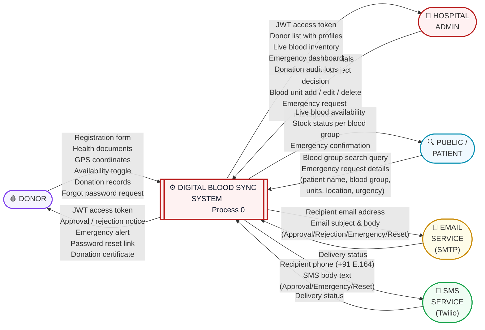
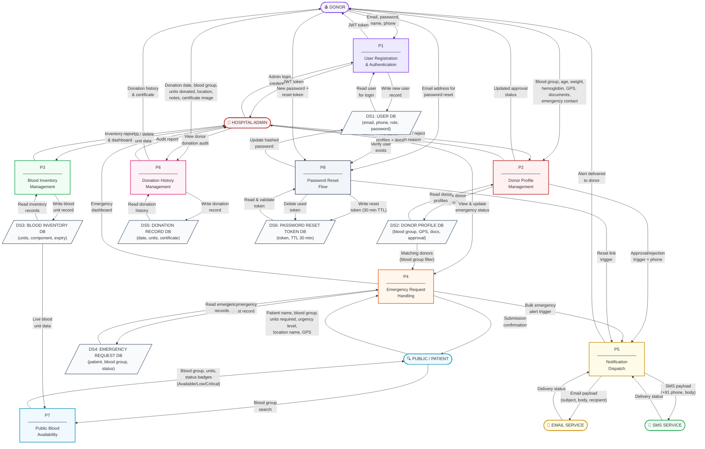

# DFD — Level 0 & Level 1
# Digital Blood Sync System

---

## LEVEL 0 — CONTEXT DIAGRAM (DFD)

> Shows the entire system as a single process. All external actors and their
> data exchanges with the system are represented. No internal detail is shown.

---

### Level 0 — Description

| Actor | Role | Data Sent INTO System | Data Received FROM System |
|---|---|---|---|
| **Donor** | Blood donor — registers, uploads documents, responds to emergencies | Registration form, health documents, GPS, availability toggle, donation records, forgot-password request | JWT token, approval/rejection email+SMS, emergency alert, reset link, donation certificate |
| **Hospital Admin** | System manager — manages blood inventory, approves donors, handles emergencies | Login credentials, approve/reject decisions, blood unit CRUD data, emergency management inputs | JWT token, donor profiles, live inventory, emergency dashboard, donation audit logs |
| **Public / Patient** | Unauthenticated user — searches blood, submits emergency | Blood group query, emergency request (patient name, blood group, units, location, urgency) | Live blood availability, stock status badges, emergency submission confirmation |
| **Email Service (SMTP)** | External notification gateway — Gmail/AWS SES | Delivery status report | Email payload: recipient, subject, body |
| **SMS Service (Twilio)** | External SMS gateway | Delivery status report | SMS payload: recipient phone (+91 E.164), SMS body |

---
---

## LEVEL 1 — DETAILED DFD

> Decomposes the system (Process 0) into 8 sub-processes. Shows internal
> data flows, all 6 data stores, and interactions between processes.

---

## Level 1 — Process Descriptions

### P1 — User Registration & Authentication
**Purpose:** Handles sign-up and login for Donors and Admin users.

| Data Flow | Direction | Description |
|---|---|---|
| Email, password, name, phone | Donor → P1 | New donor fills sign-up form |
| Admin login credentials | Admin → P1 | Admin logs into dashboard |
| JWT Token | P1 → Donor / Admin | Returned on successful login |
| Write user record | P1 → DS1 | New user saved to User DB |
| Read user for login | DS1 → P1 | Looks up user by email to verify password |

**Connects to:** DS1 (User DB)  
**Implemented in:** `users/views.py` — `RegisterView`, `LoginView`, `MeView`

---

### P2 — Donor Profile Management
**Purpose:** Manages the full donor lifecycle — registration, document upload, GPS, and admin approval.

| Data Flow | Direction | Description |
|---|---|---|
| Blood group, age, weight, hemoglobin, GPS, documents | Donor → P2 | Donor completes 4-step profile form |
| Store donor profile | P2 → DS2 | Profile written to Donor DB |
| Approve / reject with reason | Admin → P2 | Admin makes approval decision |
| Updated approval status | P2 → Donor | Donor profile status updated |
| Approval/rejection trigger + phone | P2 → P5 | Fires email + SMS notification |

**Connects to:** DS2 (Donor DB), P5 (Notification)  
**Implemented in:** `users/views.py` — `DonorViewSet`, `approve_donor`, `reject_donor`

---

### P3 — Blood Inventory Management
**Purpose:** Admin manages blood unit records — add, edit, delete. Live stock is derived from this data.

| Data Flow | Direction | Description |
|---|---|---|
| Add / edit / delete blood unit | Admin → P3 | Admin performs CRUD from dashboard |
| Write blood unit record | P3 → DS3 | Blood unit saved/updated in DB |
| Read inventory records | DS3 → P3 | Fetches current stock for dashboard |
| Inventory report | P3 → Admin | Admin sees full inventory with expiry status |

**Connects to:** DS3 (Blood Inventory DB)  
**Implemented in:** `inventory/views.py` — `BloodUnitViewSet`

---

### P4 — Emergency Request Handling
**Purpose:** Processes emergency blood requests submitted by public users and notifies matching donors.

| Data Flow | Direction | Description |
|---|---|---|
| Patient name, blood group, units, urgency, location | Public → P4 | Emergency form submitted |
| Write emergency record | P4 → DS4 | Request stored with status = Searching |
| Matching donors (blood group filter) | DS2 → P4 | Donor DB queried for matching blood group |
| Bulk emergency alert trigger | P4 → P5 | Triggers notification to all matched donors |
| Emergency dashboard | P4 → Admin | Admin sees all active emergencies |

**Connects to:** DS2, DS4, P5  
**Implemented in:** `emergency/views.py` — `EmergencyRequestViewSet.perform_create()`

---

### P5 — Notification Dispatch
**Purpose:** Central dispatcher for all email and SMS notifications — approval, rejection, emergency alerts, and password resets.

| Data Flow | Direction | Description |
|---|---|---|
| Email payload | P5 → Email Service | Subject + body + recipient sent via SMTP |
| SMS payload | P5 → SMS Service | +91 phone + body sent via Twilio API |
| Delivery status | Email/SMS → P5 | Acknowledgement returned (logged) |
| Alert delivered | P5 → Donor | Donor receives notification |

**Events that trigger P5:**
- Donor approved → approval email + SMS
- Donor rejected → rejection email + SMS with reason
- Emergency submitted → bulk email + SMS to all matching donors
- Forgot password → reset link email + SMS

**Implemented in:** `users/utils.py` — `_notify()`, `send_approval_email()`, `send_rejection_email()`, `notify_all_donors_emergency()`, `send_password_reset_email()`

---

### P6 — Donation History Management
**Purpose:** Donors log individual donation events with date, units, location, and certificate upload.

| Data Flow | Direction | Description |
|---|---|---|
| Donation date, blood group, units, location, certificate | Donor → P6 | Donor adds new donation record |
| Write donation record | P6 → DS5 | Saved to Donation Record DB |
| Read donation history | DS5 → P6 | Retrieves all past donations for donor |
| Donation history + certificate | P6 → Donor | Donor sees full history with download links |
| Audit report | P6 → Admin | Admin can view any donor's complete donation log |

**Connects to:** DS5 (Donation Record DB)  
**Implemented in:** `emergency/views.py` — `DonationRecordViewSet`

---

### P7 — Public Blood Availability
**Purpose:** Serves live blood stock data to public users without requiring login.

| Data Flow | Direction | Description |
|---|---|---|
| Blood group search | Public → P7 | User selects a blood group to check |
| Live blood unit data | DS3 → P7 | Reads all non-expired units from Blood Inventory DB |
| Blood group, units, status badges | P7 → Public | Returns Available / Low Stock / Critical / Out of Stock |

**Connects to:** DS3 (Blood Inventory DB)  
**Implemented in:** `inventory/views.py` — `public_blood_summary()` (AllowAny permission)

---

### P8 — Password Reset Flow
**Purpose:** Securely handles forgot-password requests with a time-limited, single-use token.

| Data Flow | Direction | Description |
|---|---|---|
| Email address for reset | Donor → P8 | Donor submits forgot-password form |
| Verify user exists | DS1 → P8 | Checks USER DB for the email |
| Write reset token (30-min TTL) | P8 → DS6 | One-time token stored |
| Reset link trigger | P8 → P5 | P5 fires email + SMS with reset URL |
| New password + reset token | Donor → P8 | Donor opens link and submits new password |
| Update hashed password | P8 → DS1 | New bcrypt password hash written to USER DB |
| Delete used token | P8 → DS6 | Token destroyed — prevents reuse |

**Connects to:** DS1, DS6, P5  
**Implemented in:** `users/views.py` — `forgot_password()`, `reset_password()`

---

## Data Store Summary

| Store | Tables (Django Models) | Used By |
|---|---|---|
| **DS1 — User DB** | `User` (AbstractUser) | P1, P2, P8 |
| **DS2 — Donor Profile DB** | `Donor` | P2, P4, P6 |
| **DS3 — Blood Inventory DB** | `BloodUnit` | P3, P7 |
| **DS4 — Emergency Request DB** | `EmergencyRequest`, `DonorResponse` | P4 |
| **DS5 — Donation Record DB** | `DonationRecord` | P6 |
| **DS6 — Password Reset Token DB** | `PasswordResetToken` | P8 |
